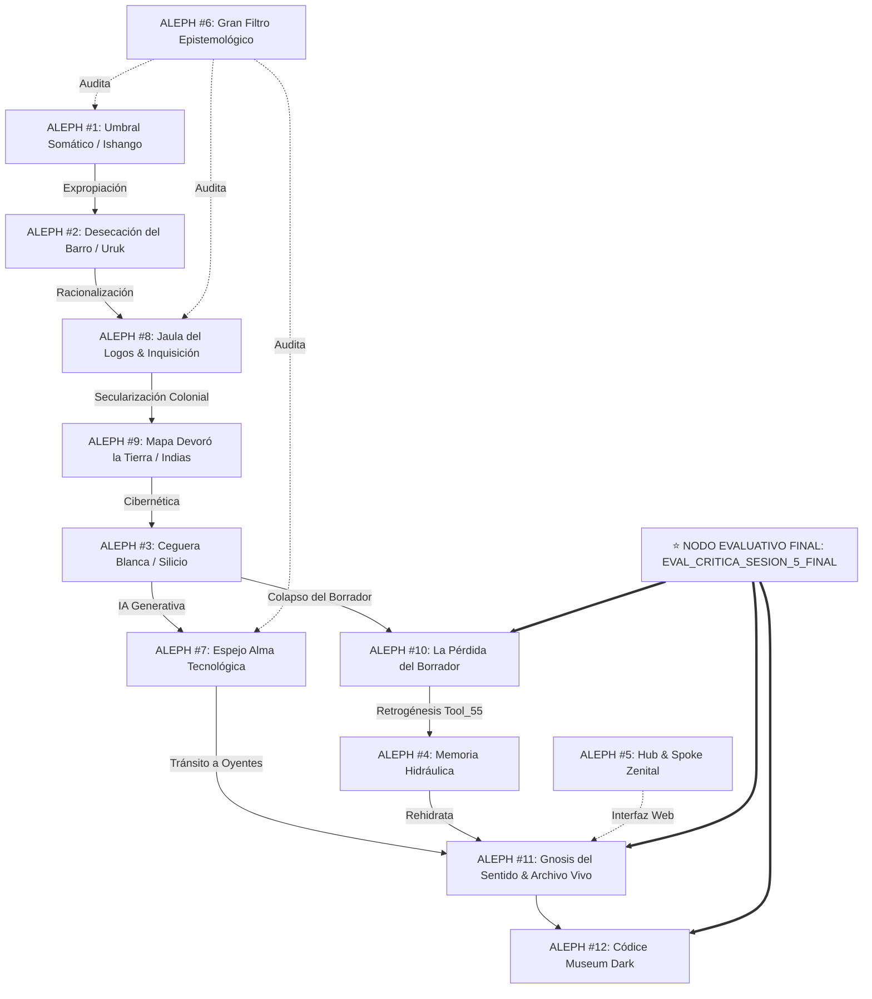

# TGP SINAXIS — CORPUS MAESTRO DE INGESTA ATÓMICA (14 FUENTES COMPLETAS)
> **Plataforma:** The Great Puzzle Project (TGP)  
> **Dirección y Autoría:** Xavier Benítez  
> **Ecosistema:** Neo4j Graph DB + Antigravity IDE + Cloudflare D1  
> **Lente Epistémico:** Arqueosemiótica, Neurognosis y Humanismo Somático  
> **Glosario Completo de 12 Puntos Aleph:** [`tgp_aleph_confluencia_inbox.md`](file:///C:/Users/ygnat/.gemini/antigravity-ide/brain/d03cd838-4b2a-4240-9505-d5e7a6ab6294/tgp_aleph_confluencia_inbox.md)

---

## 📌 ÍNDICE GENERAL DE FUENTES INGESTADAS (CIERRE MAESTRO)

- **Sesión 1 (Fundamentos y Arquitectura):**
  - `[Fuente 01]` Mapa Narrativo Detallado — *Historia del Archivo* (Versión EDC)
  - `[Fuente 02]` Plan de Maquetación EDC — *Historia del Archivo* (Canon v1.0, 9 Capítulos, Museum Dark)
  - `[Fuente 03]` Estructura General — *Método del Embudo TGP* (Esquema Canónico de 12 Capítulos)
  - `[Arquitectura Web]` Hub & Spoke Zenital, `AdnBentoGsap`, CS01-CS10 y Manifiesto Integrado  
    ➔ **Confluencia:** [`[ALEPH #5 · HUB & SPOKE ZENITAL]`](file:///C:/Users/ygnat/.gemini/antigravity-ide/brain/d03cd838-4b2a-4240-9505-d5e7a6ab6294/tgp_aleph_confluencia_inbox.md#aleph-5--hub--spoke-zenital-la-interfaz-como-prótesis-epistémica)
- **Sesión 2 (La Trilogía del Despojo Material):**
  - `[Fuente 04]` Capítulo 1: *El impulso de guardar* (Del rastro al archivo / Ishango)  
    ➔ **Confluencia:** [`[ALEPH #1 · UMBRAL SOMÁTICO]`](file:///C:/Users/ygnat/.gemini/antigravity-ide/brain/d03cd838-4b2a-4240-9505-d5e7a6ab6294/tgp_aleph_confluencia_inbox.md#aleph-1--umbral-somático-el-punto-cero-del-sentido)
  - `[Fuente 06]` Capítulo 2: *Del templo al palacio* (El archivo se vuelve poder / Uruk y Egipto)  
    ➔ **Confluencia:** [`[ALEPH #2 · LA DESECACIÓN DEL BARRO]`](file:///C:/Users/ygnat/.gemini/antigravity-ide/brain/d03cd838-4b2a-4240-9505-d5e7a6ab6294/tgp_aleph_confluencia_inbox.md#aleph-2--la-desecación-del-barro-y-el-nacimiento-del-archivo-solar)
  - `[Fuente 05]` Capítulo 6: *El Archivo Planetario* (La memoria global y la ilusión de lo total / Silicio)  
    ➔ **Confluencia:** [`[ALEPH #3 · CEGUERA BLANCA]`](file:///C:/Users/ygnat/.gemini/antigravity-ide/brain/d03cd838-4b2a-4240-9505-d5e7a6ab6294/tgp_aleph_confluencia_inbox.md#aleph-3--ceguera-blanca-y-el-archivo-planetario)
- **Sesión 3 (ADN Intelectual, Guardrails y Giro al Oyente):**
  - `[Fuente 07]` Reconstrucción del ADN Intelectual, Auditoría Crítica y Matriz `llms.txt`  
    ➔ **Confluencia:** [`[ALEPH #6 · EL GRAN FILTRO EPISTEMOLÓGICO]`](file:///C:/Users/ygnat/.gemini/antigravity-ide/brain/d03cd838-4b2a-4240-9505-d5e7a6ab6294/tgp_aleph_confluencia_inbox.md#aleph-6--el-gran-filtro-epistemológico-la-desambiguación-somática)
  - `[Fuente 08]` Esquema Canónico de 12 Capítulos + Cap. 8: *El Alma Tecnológica* (IA y Deepfakes)  
    ➔ **Confluencia:** [`[ALEPH #7 · EL ESPEJO DEL ALMA TECNOLÓGICA]`](file:///C:/Users/ygnat/.gemini/antigravity-ide/brain/d03cd838-4b2a-4240-9505-d5e7a6ab6294/tgp_aleph_confluencia_inbox.md#aleph-7--el-espejo-del-alma-tecnológica-de-custodios-a-oyentes)
  - `[Fuente 09]` Epílogo Editorial EDC (*El eco del archivo*) + Índice Comentado Ampliado
  - ⭐ **Auditoría Crítica Sesión 3:** [`[EVAL_CRITICA_SESION_3]`](file:///C:/Users/ygnat/.gemini/antigravity-ide/brain/d03cd838-4b2a-4240-9505-d5e7a6ab6294/tgp_aleph_confluencia_inbox.md#nodo-evaluativo-visible-eval_critica_sesion_3-dictamen-epistémico-antigravity)
- **Sesión 4 (La Tríada del Confinamiento Simbólico):**
  - `[Nodo C]` Capítulo 3: *La invención del canon* (Grecia y Roma)  
  - `[Nodo A]` Capítulo 4: *La verdad como texto* (Monoteísmos e Inquisición)  
    ➔ **Confluencia:** [`[ALEPH #8 · LA JAULA DEL LOGOS Y LA INQUISICIÓN]`](file:///C:/Users/ygnat/.gemini/antigravity-ide/brain/d03cd838-4b2a-4240-9505-d5e7a6ab6294/tgp_aleph_confluencia_inbox.md#aleph-8--la-jaula-del-logos-y-la-inquisición-el-verbo-como-algoritmo)
  - `[Nodo B]` Capítulo 5: *Del papel a la razón* (Gutenberg, Enciclopedia y Archivo de Indias)  
    ➔ **Confluencia:** [`[ALEPH #9 · EL MAPA QUE DEVORÓ LA TIERRA]`](file:///C:/Users/ygnat/.gemini/antigravity-ide/brain/d03cd838-4b2a-4240-9505-d5e7a6ab6294/tgp_aleph_confluencia_inbox.md#aleph-9--el-mapa-que-devoró-la-tierra-gutenberg-y-el-archivo-de-indias)
  - `[Nodo D]` Mapa Narrativo Detallado EDC (Los 4 Movimientos y Arco Lógico-Emocional)
  - ⭐ **Auditoría Crítica Sesión 4:** [`[EVAL_CRITICA_SESION_4]`](file:///C:/Users/ygnat/.gemini/antigravity-ide/brain/d03cd838-4b2a-4240-9505-d5e7a6ab6294/tgp_aleph_confluencia_inbox.md#nodo-evaluativo-visible-eval_critica_sesion_4-la-tríada-del-confinamiento-simbólico)
- **Sesión 5 (La Gran Confluencia y el Archivo Encarnado):**
  - `[Fuente 13]` Capítulo 7: *La rebelión de la memoria* (El retorno del agua interior / Retrogénesis)  
    ➔ **Confluencia:** [`[ALEPH #10 · LA PÉRDIDA DEL BORRADOR]`](file:///C:/Users/ygnat/.gemini/antigravity-ide/brain/d03cd838-4b2a-4240-9505-d5e7a6ab6294/tgp_aleph_confluencia_inbox.md#aleph-10--la-pérdida-del-borrador-la-rebelión-de-la-memoria)
  - `[Fuente 14]` Capítulo 9: *La Gnosis del Sentido* (Del archivo muerto al archivo vivo)  
    ➔ **Confluencia:** [`[ALEPH #11 · LA GNOSIS DEL SENTIDO Y EL ARCHIVO VIVO]`](file:///C:/Users/ygnat/.gemini/antigravity-ide/brain/d03cd838-4b2a-4240-9505-d5e7a6ab6294/tgp_aleph_confluencia_inbox.md#aleph-11--la-gnosis-del-sentido-y-el-archivo-vivo-la-gran-confluencia)
  - `[Fuente 15]` Plan de Maquetación EDC (*Canon Maestro v1.9 / Museum Dark*) + `[Bloque 6]` Sinopsis Magistral (*Del barro al algoritmo: la biografía secreta de nuestra memoria*)  
    ➔ **Confluencia:** [`[ALEPH #12 · EL CÓDICE MUSEUM DARK]`](file:///C:/Users/ygnat/.gemini/antigravity-ide/brain/d03cd838-4b2a-4240-9505-d5e7a6ab6294/tgp_aleph_confluencia_inbox.md#aleph-12--el-códice-museum-dark-la-biografía-secreta-de-la-memoria)
  - ⭐ **Auditoría Crítica Cumbre Sesión 5:** [`[EVAL_CRITICA_SESION_5_FINAL]`](file:///C:/Users/ygnat/.gemini/antigravity-ide/brain/d03cd838-4b2a-4240-9505-d5e7a6ab6294/tgp_aleph_confluencia_inbox.md#nodo-evaluativo-visible-eval_critica_sesion_5_final-el-archivo-encarnado-y-la-reconciliación-del-sentido)
- **Síntesis Dialéctica:**
  - `[Reconciliación Total]` Retorno de la Memoria Viva y Ecología del Sentido  
    ➔ **Confluencia:** [`[ALEPH #4 · MEMORIA HIDRÁULICA]`](file:///C:/Users/ygnat/.gemini/antigravity-ide/brain/d03cd838-4b2a-4240-9505-d5e7a6ab6294/tgp_aleph_confluencia_inbox.md#aleph-4--memoria-hidráulica-y-ecología-del-sentido)

---

## 🏛️ SESIÓN 5: LA REBELIÓN DE LA MEMORIA Y LA GNOSIS DEL ARCHIVO VIVO

### [Fuente 13] Capítulo 7: La rebelión de la memoria (El retorno del agua interior)
> 🏷️ **Confluencia Crítica:** [`[ALEPH #10 · LA PÉRDIDA DEL BORRADOR]`](file:///C:/Users/ygnat/.gemini/antigravity-ide/brain/d03cd838-4b2a-4240-9505-d5e7a6ab6294/tgp_aleph_confluencia_inbox.md#aleph-10--la-pérdida-del-borrador-la-rebelión-de-la-memoria)
* **La sospecha ontológica del siglo XXI:** El archivo digital reproduce pero no recuerda; la hiperconsistencia del dato amputa la fragilidad creativa.
* **La cultura del historial:** Al criminalizarse el olvido biológico, la vida pierde su borrador y desaparecen el perdón y la metamorfosis.
* **Activación de la Retrogénesis (`TOOL_55`):** Descenso al humedal límbico donde la neurociencia confirma que sin emoción no hay memoria viva.
* **Axioma:** *"La memoria no se conserva: se cultiva. Y como toda agua viva, solo fluye cuando se comparte."*

### [Fuente 14] Capítulo 9: La Gnosis del Sentido (Del archivo muerto al archivo vivo)
> 🏷️ **Confluencia Crítica:** [`[ALEPH #11 · LA GNOSIS DEL SENTIDO Y EL ARCHIVO VIVO]`](file:///C:/Users/ygnat/.gemini/antigravity-ide/brain/d03cd838-4b2a-4240-9505-d5e7a6ab6294/tgp_aleph_confluencia_inbox.md#aleph-11--la-gnosis-del-sentido-y-el-archivo-vivo-la-gran-confluencia)
* **Ceguera existencial del Big Data:** Predice conductas pero ignora el consuelo y el amor; el exceso de datos produce un vacío más hondo que la ignorancia.
* **La Gran Confluencia TGP:** Unificación de `TOOL_51` (Ecología del Sentido), `TOOL_53` (Dialéctica Solar-Lunar), `TOOL_56` (Hidromemoria) y `TOOL_57` (Inconsciente Hidrosimbólico).
* **El Humano como Archivo Encarnado:** El archivo ya no es una jaula exterior ni un cementerio de datos, sino un órgano vivo del alma planetaria.
* **Axioma:** *"Cuando la memoria se reconcilia con el olvido, el archivo vuelve a respirar. Recordar es crear."*

### [Fuente 15 + Bloque 6] Canon Museum Dark y Sinopsis Magistral
> 🏷️ **Confluencia Crítica:** [`[ALEPH #12 · EL CÓDICE MUSEUM DARK]`](file:///C:/Users/ygnat/.gemini/antigravity-ide/brain/d03cd838-4b2a-4240-9505-d5e7a6ab6294/tgp_aleph_confluencia_inbox.md#aleph-12--el-códice-museum-dark-la-biografía-secreta-de-la-memoria)
* **Estética Museum Dark:** Fondo grafito (`#0A0D14`), acentos cian brillante (`#00EAFF`) y oro tenue (`#F2C779`). Tipografías *Neue Montreal + IBM Plex Sans + Lora*.
* **Puente al Volumen II:** Clausura de *Historia del Archivo* (logos solar) y apertura hacia *La Rebelión de la Memoria* (*"Donde el alma se libera del archivo y vuelve a hablar en agua"*).
* **Sinopsis Magistral:** Del hueso paleolítico de Ishango a la inteligencia artificial: el ser humano no está parado frente a la historia, es el archivo encarnado.

---

## 🌌 MAPA CUMBRE DE LA RED DE PUNTOS ALEPH (12 CONFLUENCIAS)

